<picture>
  <source media="(prefers-color-scheme: dark)" srcset="assets/banner-dark.svg">
  <source media="(prefers-color-scheme: light)" srcset="assets/banner-light.svg">
  
</picture>

  
  
  

### 👋 About me

I'm a CS undergrad at **VIT Bhopal University** who likes going one layer lower than the tutorial goes. Most of my time splits between two things: **computer vision**, where I teach classical CV pipelines to pull clean information out of messy video, and **core systems fundamentals**: C, Java, and the DSA grind that makes everything else easier. The web work sits in between, because a model nobody can use isn't finished.

- 🎞️ **Recently shipped:** [SlideSnap](https://github.com/suhail17651/SlideSnap), which turns a lecture recording into a searchable slide PDF and PPTX
- 🧮 **Currently grinding:** data structures & algorithms in C and Java, consistency over cramming
- 🌱 **Learning next:** deeper backend work with Node.js, and shipping projects end to end
- 💬 **Open to:** SWE internships, open-source issues, and anyone who wants a second pair of eyes on their code

### 🛠️ Featured work

<table>
  <tr>
    <td width="55%" valign="top">
      <a href="https://github.com/suhail17651/SlideSnap"><picture><source media="(prefers-color-scheme: dark)" srcset="assets/slidesnap-dark.svg"></picture></a>
    </td>
    <td width="45%" valign="top">
      <h4>SlideSnap 🎞️</h4>
      
Hours of lecture video, turned into a searchable deck. SlideSnap finds every distinct slide using frame differencing + SSIM, picks the sharpest frame, straightens camera tilt with a homography, removes projector glare, runs OCR, merges bullet-by-bullet builds, and exports a bookmarked PDF and an editable PPTX.

      
Classical CV only, CPU-based and deterministic. No black-box scene detection.

      
      
      
      
        
      <b><a href="https://github.com/suhail17651/SlideSnap">Code ↗</a></b>
    </td>
  </tr>
</table>

<table>
  <tr>
    <td width="50%" valign="top">
      <a href="https://github.com/suhail17651/Campus-Course-Records-Manager-CCRM"><picture><source media="(prefers-color-scheme: dark)" srcset="assets/ccrm-dark.svg"></picture></a>
      <h4>Campus Course &amp; Records Manager</h4>
      
A menu-driven Java console app for students, courses, enrollments, grades and transcripts. It's an exercise in doing OOP properly: an abstract <code>Person</code>, builders, enums with fields, custom exceptions, CSV import/export.

      
      
        
      <b><a href="https://github.com/suhail17651/Campus-Course-Records-Manager-CCRM">Code ↗</a></b>
    </td>
    <td width="50%" valign="top">
      <a href="https://github.com/suhail17651/OSS-AUDIT-24BAI10942"><picture><source media="(prefers-color-scheme: dark)" srcset="assets/ossaudit-dark.svg"></picture></a>
      <h4>OSS Audit</h4>
      
Five bash scripts auditing Git (GPL v2) on Linux: system identity, package and license check, disk and permission audit, log analysis, and an interactive open-source manifesto generator.

      
      
      
        
      <b><a href="https://github.com/suhail17651/OSS-AUDIT-24BAI10942">Code ↗</a></b>
    </td>
  </tr>
</table>

### 🧰 Toolkit

  <b>Languages</b> 
  

  <b>Web</b> 
  

  <b>ML / Vision</b> 
  

  <b>Tools</b> 
  

### 🧭 How I think about building

No grand process, just a loop I trust:

> **1.** Understand the problem before touching the keyboard → **2.** Build the simplest version that actually runs → **3.** Break it on purpose → **4.** Fix, learn, repeat

Reading code counts as building. So does deleting it.

### 🎯 Off the keyboard

<table>
  <tr><td>🎮</td><td><b>Gaming</b>, mostly Clash Royale, for the same reason I like DSA: limited resources, one right move</td></tr>
  <tr><td>📸</td><td><b>Photography</b>: teaching a model to see makes you pay a lot more attention to how <i>you</i> see</td></tr>
  <tr><td>🏄</td><td><b>Tech surfing</b>: new tools, new releases, the endless scroll of things worth trying</td></tr>
  <tr><td>🐱</td><td><b>The cat in the banner</b>: my co-op partner. Great reflexes, terrible at DSA</td></tr>
</table>

### 📫 Let's connect

  
  

Thanks for stopping by. Let's build something.

